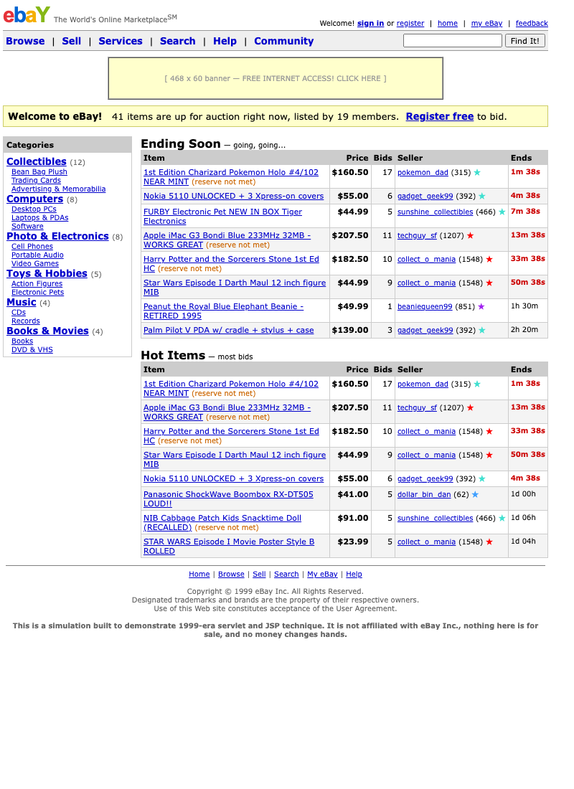

# eBay, 1999 — a Model 2 servlet + JSP application

An auction site built the way J2EE web applications were built when JSP was
new: **servlet controllers, JavaBean model, JSP 1.2 views, and a custom tag
library**, wired by a hand-written Servlet 2.3 `web.xml`.



## Run it

```sh
./run.sh                 # docker build + docker run
open http://localhost:8081/
```

Sign in as **guest / ebay**, or register a new User ID. Every seeded member
also uses the password `ebay`, so you can sign in as `beaniequeen99` to see a
seller's view or `sniper_steve` to bid against yourself.

```sh
docker logs -f ebay      # Tomcat's log
docker rm -f ebay        # stop
```

The marketplace opens with 43 auctions across 18 members — Beanie Babies, a
1st Edition Charizard, a Bondi Blue iMac, a Furby, and somebody's Y2K survival
kit. Some listings end within minutes of boot, so auctions close and winners
are declared while you watch.

## Proxy bidding, which is the whole point

You enter the most you will pay. The site bids for you, raising by the
smallest increment needed to keep you in the lead, and stops at your maximum.
The displayed price is therefore driven by the **loser's** ceiling, not the
winner's.

Verified against the running app:

| Step | What happens | Price | High bidder |
|---|---|---|---|
| Opening | listing starts at $10.00 | $10.00 | — |
| guest enters a **$50.00** maximum | price does not move — nobody to outbid | $10.00 | guest |
| sniper_steve enters **$45.00** | runs into guest's hidden proxy and is outbid instantly | **$46.00** | guest |
| sniper_steve returns with **$60.00** | takes the lead, but only pays one increment over guest's $50 | **$51.00** | sniper_steve |

The bid history records both halves of that middle step — the challenger's
$45.00 and the standing proxy's automatic $46.00 answer. That cascade of bids
placed by nobody is what a real eBay history looked like.

Increments follow eBay's published table ($0.05 under a dollar, rising to
$100 over $5,000), reserve prices keep an item from selling below a secret
floor, and a background `Timer` closes auctions and lets the seeded members
snipe in the last three minutes.

## Why this app, and not the Napster one

`~/napster-servlet` is a desktop-client simulation: real-time progress that
needs client-pull hacks, dense grids assembled in Java, almost no page flow.
JSP's home turf is the opposite — forms that can fail, multi-step flow, and
paginated tables. Nearly every screen here is a form that can be rejected:

- **Bidding** is two steps — enter a maximum, review a page that spells out
  the commitment, confirm. Every failure (below minimum, own item, auction
  closed, unparseable amount) lands back on the review page with the message
  and the amount still in the box.
- **Sell Your Item** validates seven fields and redisplays the whole form
  with the member's input intact, then redirects on success so a refresh
  cannot list the item twice.
- **Browse and Search** are one controller behind two URL patterns, rendering
  one view, paginated 25 to a page.

## The JSP 1.2 toolkit, and only that

`web.xml` declares the Servlet 2.3 DTD, and that choice has teeth: Jasper
compiles the pages as JSP 1.2, so `${...}` expression language is **off**.
Drop `${1 + 1}` into a page and it renders literally, because EL did not
arrive until JSP 2.0 in 2003. The container enforces the period.

So the pages use what 1999–2001 actually had:

| Technique | Where |
|---|---|
| `<%@ include file %>` — static, spliced in before compiling | `header.jsp` / `footer.jsp`, sharing the caller's locals |
| `<jsp:include>` + `<jsp:param>` — runtime, its own servlet | `itemrows.jsp`, which renders any list named by a param |
| `<jsp:forward>` | `index.jsp`, the welcome file, dispatching to the home controller |
| `<%@ page isErrorPage %>` + `exception` | `error.jsp`, the `<error-page>` target |
| Scriptlets and expressions | everywhere a value or a loop is needed |

### The tag library

`WEB-INF/ebay.tld` declares seven tags, each a handler class extending
`TagSupport` with a setter per attribute. This is the part a pure-servlet app
cannot demonstrate:

| Tag | Does |
|---|---|
| `<ebay:money cents="…"/>` | long cents → `$1,234.56` |
| `<ebay:timeLeft end="…"/>` | countdown, turning red inside the last hour |
| `<ebay:feedback user="…"/>` | nick + score + star in its colour tier, linked to the profile |
| `<ebay:esc value="…"/>` | HTML escaping — what `c:out` did from 2002 |
| `<ebay:pageLinks page pages base/>` | `< Previous 1 [2] 3 Next >` |
| `<ebay:loggedIn>` / `<ebay:anonymous>` | conditional body tags — `EVAL_BODY_INCLUDE` or `SKIP_BODY` |

The star tiers are eBay's own: yellow at 10, blue at 50, turquoise at 100,
purple at 500, red at 1,000, green at 5,000, shooting star at 10,000.

Handlers are pooled and reused by the container, so each one clears its
attributes in `doEndTag()` — a detail that bit everybody at least once.

## Layout

```
src/mx/jehualli/ebay/model/        Item (the proxy-bid state machine), Bid, User, Category, Feedback
src/mx/jehualli/ebay/service/      AuctionHouse, AuctionCloser (the clock), BidResult
src/mx/jehualli/ebay/util/         Money, Stars, Text
src/mx/jehualli/ebay/seed/         SeedData
src/mx/jehualli/ebay/web/          BaseController + one controller per use case, Boot
src/mx/jehualli/ebay/web/filter/   SignInFilter
src/mx/jehualli/ebay/tags/         seven TagSupport handlers
webapp/WEB-INF/web.xml             Servlet 2.3 descriptor — element order fixed by the DTD
webapp/WEB-INF/ebay.tld            the tag library descriptor
webapp/WEB-INF/jsp/                the views, under WEB-INF so no one can request one directly
webapp/index.jsp                   welcome file, <jsp:forward> to /home
Dockerfile               tomcat:9.0-jdk17 — javac against Tomcat's own jars, no Maven
```

Tomcat 9 is the last release line implementing `javax.servlet` (Tomcat 10
moved to `jakarta.servlet`), and it ships Jasper, so the JSPs compile on first
request exactly as they did then.

State is in memory: restart the container and it is late 1999 again.
Timestamps are shifted so the current year prints as `99`.

**This is a simulation for demonstrating 1999-era technique. It is not
affiliated with eBay Inc., nothing is for sale, and no money changes hands.**
